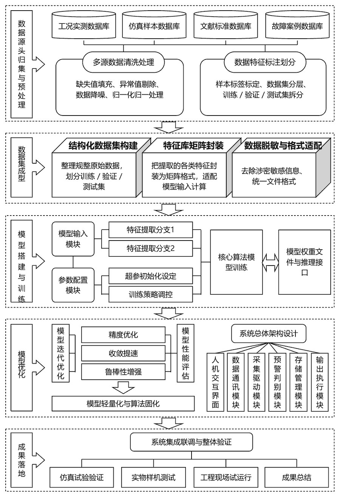

# tikz-flowchart-replica

把位图流程图重绘为**像素级对齐**的 TikZ 矢量图。

面向学术论文、技术文档里的研究框架图 / 技术路线图 / 系统架构图——这类图的特点是同质元素多（几十个方框）、连线规则（树形支架、虚线分组容器）、中文排版（竖排标签、多行窄栏），肉眼目测重画必然错在行高、间距和连线端点上。

本项目提供一套**可复现的方法 + 三个可直接运行的脚本**，把"照着重画"变成"先测量、再生成、后比对"的确定性流程。

## 效果

| 示例 | 内容 | 规模 |
|---|---|---|
| [01 顶层规划图](examples/01-top-level-plan) | 工业大模型落地总体顶层规划 | 单列 5 段、约 20 个元素 |
| [02 研究框架图](examples/02-research-framework) | 研究内容 / 研究方法 / 研究步骤三列框架 | 约 60 个元素、5 个虚线容器 |
| [03 技术架构图](examples/03-tech-architecture) | 数据处理 → 模型搭建 → 模型优化 → 成果落地 | 约 70 个元素、圆柱 / 立体卡片 / 竖排标签 |

> 三个示例的源图均为已发表论文插图，未随仓库分发；`examples/*/preview.png` 是复刻结果。

预览：

 

## 四条铁律

1. **先量后画** —— 所有坐标来自像素测量，不靠目测。
2. **坐标即像素** —— `x=0.0138889cm, y=-0.0138889cm`，1 单位 = 1px = 1/72cm，代码里直接写原图坐标。
3. **用脚本生成 TikZ** —— 几十个节点手写必错，改动成本极高。数据表与渲染函数分离。
4. **必须叠色比对** —— 渲染 → 叠色 → 找差异 → 改生成器 → 再比对，直到线条重合。

## 环境

- TeX Live（需 `xelatex`、`xeCJK`、`fontspec`）
- 中文字体：Windows 用 `Microsoft YaHei`，其它平台改 `\setCJKmainfont`（思源黑体 / Noto Sans CJK 均可）
- Python 3.8+：`pip install numpy pillow pymupdf`

## 快速开始

```bash
# 1) 量取几何：先看清骨架
python scripts/measure.py hlines 素材/fig.jpg --x0 300 --x1 920
python scripts/measure.py edges  素材/fig.jpg --y0 215 --y1 260      # 一排框的左右边界
python scripts/measure.py ink    素材/fig.jpg --x0 330 --y0 75 --x1 450 --y1 110 --chars 7
python scripts/measure.py art    素材/fig.jpg --x0 300 --y0 118 --x1 920 --y1 250

# 2) 写生成器（从骨架开始）
cp scripts/scaffold.py gen.py        # 把测得的坐标填进去
python gen.py && xelatex fig.tex

# 3) 叠色比对，迭代到重合
python -c "import pymupdf; pymupdf.open('fig.pdf')[0].get_pixmap(dpi=183).save('out.png')"
python scripts/overlay.py 素材/fig.jpg out.png --orig 141,38,1076,1417 --out overlay.png --diff
```

叠色图的颜色语义：**红 = 我的、蓝 = 原图、黑 = 重合**。

## 目录

```
docs/                       方法详解（按工作流顺序编排）
  00-workflow.md            7 步工作流总览与判定标准
  01-measure.md             从位图量取几何：三类扫描、虚线识别、字号推算、ASCII 结构图
  02-tex-setup.md           工程配置：单位、字号 px→pt 换算表、线宽、颜色、编译
  03-shapes.md              图元库：矩形/圆角/胶囊/圆柱/立体卡片/块箭头/树形支架/共边标签框
  04-text.md                中文排版：字号=字宽、逐字逐行定位、竖排、行距、换行照抄
  05-verify.md              叠色比对：1:1 渲染、偏移换算、症状→修法对照表
  06-pitfalls.md            15 条真实踩坑
scripts/
  measure.py                几何测量 CLI（hlines/vlines/edges/dashed/ink/row/col/art）
  overlay.py                红蓝叠色比对，含差异图与"原图独有像素占比"
  scaffold.py               生成器骨架（box / mlines / chars_at / varrow / cylinder / box3d / label_box / tree）
examples/
  01-top-level-plan/        手写版（小图，约 20 个元素）
  02-research-framework/    gen.py 版（60 元素，5 个虚线容器）
  03-tech-architecture/     gen.py 版（70 元素，含圆柱与立体卡片）
```

每个示例目录都有 `gen.py`（若为生成式）、`fig.tex`、`fig.pdf`、`preview.png`，可直接 `xelatex fig.tex` 复现。

## 为什么不能直接画

三个真实翻车案例，都是"看起来画对了"但实际错在细节：

| 症状 | 真因 |
|---|---|
| 空心箭头只剩一个三角 | 总高 16px、箭头长 13px，箭轴只剩 3px。约束：**总高 ≥ 头长 + 8** |
| 外围被画成一个大虚线框 | 实际是**三个并排的虚线单元**。虚线覆盖率只有 55%，用 0.7 阈值扫描会整条漏掉 |
| 方框被一条斜线穿过 | 三段式路径的末段加了 `-- cycle`，`cycle` 回到的是**当前子路径起点**，不是整条 path 的起点 |

这些靠肉眼扫全图都发现不了，只有叠色图能一眼看出来。详见 [docs/06-pitfalls.md](docs/06-pitfalls.md)。

## 适用范围与限制

适用：正交排布的流程图、框架图、架构图，中文或中英混排，黑白/灰阶印刷风格。

不适用：
- 自由曲线、手绘风格、大量斜线交叉的图
- 需要严格还原原图滤镜、阴影、渐变的效果图
- 位图里文字本身模糊到无法辨认时（先人工确认文字）

字体差异（笔画粗细、字面大小）无法做到与位图逐像素一致，叠色图上会有 1~2px 的亚像素边缘差，属正常范围。

## License

[MIT](LICENSE)
