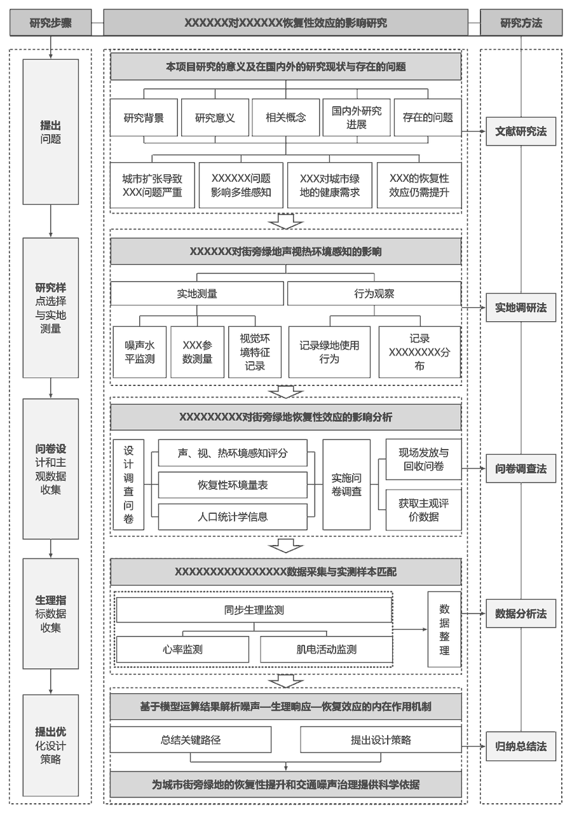

# tikz-flowchart-replica

一个通用的 **Agent Skill**：把位图流程图重绘为**像素级对齐**的 TikZ 矢量图。

适用于学术论文、技术文档里的研究框架图、技术路线图、系统架构图——这类图几十个同质方框、连线规则（树形支架、虚线分组容器）、中文排版（竖排标签、多行窄栏），靠肉眼重画必然错在行高、间距和连线端点上。这个技能把它变成"先测量、再生成、后比对"的确定性流程。

仓库本身是**承载这个 skill 的项目**：README / LICENSE 等外围文件在根目录，skill 本体在 [`tikz-flowchart-replica/`](tikz-flowchart-replica) 子目录，结构与安装到 skills 目录里的完全一致，拷走即用。

## 效果

| 示例 | 内容 | 规模 |
|---|---|---|
| [01 顶层规划图](tikz-flowchart-replica/assets/examples/01-top-level-plan) | 工业大模型落地总体顶层规划 | 单列 5 段，约 20 个元素 |
| [02 研究框架图](tikz-flowchart-replica/assets/examples/02-research-framework) | 研究内容 / 研究方法 / 研究步骤三列框架 | 约 60 个元素、5 个虚线容器 |
| [03 技术架构图](tikz-flowchart-replica/assets/examples/03-tech-architecture) | 数据处理 → 模型搭建 → 模型优化 → 成果落地 | 约 70 个元素，含圆柱、立体卡片、竖排标签 |

 

> 复刻对象是已发表论文的插图，源图未随仓库分发，上面的图为复刻结果。各示例目录内都有 `fig.pdf` 与 `preview.png`。

## 安装

这是一个标准 **Agent Skill**：`SKILL.md` + YAML frontmatter + `references/` `scripts/` `assets/`，遵循通用的 skill 目录约定，凡支持该规范的智能体都能直接加载，不含任何平台专有依赖。

把 `tikz-flowchart-replica/` 子目录整个拷到你的智能体的 skills 目录即可：

```bash
git clone https://github.com/<you>/tikz-flowchart-replica.git
cp -r tikz-flowchart-replica/tikz-flowchart-replica <你的 skills 目录>/
```

skills 目录通常位于用户主目录下（如 `~/.claude/skills/`），也可放在项目内随仓库分发；具体路径以你所用的客户端为准。

装好后，说"用 tikz 复刻这个流程图"、"把这张图做成矢量图"、"redraw this diagram in LaTeX" 即可触发。

## 环境依赖

- TeX Live，需 `xelatex` + `xeCJK` + `fontspec`
- 中文字体：Windows 用 `Microsoft YaHei`；其它平台改 `\setCJKmainfont`（思源黑体 / Noto Sans CJK 均可）
- Python 3.8+：`pip install numpy pillow pymupdf`

## 技能怎么工作

四条铁律：

1. **先量后画** —— 所有坐标来自像素测量，不靠目测
2. **坐标即像素** —— `x=0.0138889cm, y=-0.0138889cm`，1 单位 = 1px = 1/72cm，代码里直接写原图坐标
3. **用脚本生成 TikZ** —— 几十个节点手写必错；数据表与渲染函数分离
4. **必须叠色比对** —— 渲染 → 叠色 → 找差异 → 改生成器 → 再比对，直到线条重合

七步工作流：分清图与页面 → 量取几何 → 工程配置 → 拆解图元 → 写生成器 → 编译 → 叠色迭代。详见 [`SKILL.md`](tikz-flowchart-replica/SKILL.md) 与 [`references/`](tikz-flowchart-replica/references)。

## 仓库结构

```
.
├── README.md                  ← 你正在看的
├── LICENSE
├── .gitignore
├── .gitattributes
└── tikz-flowchart-replica/    ← skill 本体
    ├── SKILL.md               入口：四条铁律 + 7 步工作流 + 索引
    ├── references/            方法详解，按需加载
    │   ├── 01-measure.md      从位图量取几何：三类扫描、虚线识别、字号推算、ASCII 结构图
    │   ├── 02-tex-setup.md    工程配置：单位、字号 px→pt 换算表、线宽、颜色、编译
    │   ├── 03-shapes.md       图元库：矩形/圆角/胶囊/圆柱/立体卡片/块箭头/树形支架/共边标签框
    │   ├── 04-text.md         中文排版：字号=字宽、逐字逐行定位、竖排、行距、换行照抄
    │   ├── 05-verify.md       叠色比对：1:1 渲染、偏移换算、症状→修法对照表
    │   └── 06-pitfalls.md     15 条真实踩坑
    ├── scripts/
    │   ├── measure.py         几何测量 CLI：hlines / vlines / edges / dashed / ink / row / col / art
    │   ├── overlay.py         红蓝叠色比对，含差异图与"原图独有像素占比"
    │   └── scaffold.py        生成器骨架：box / mlines / chars_at / varrow / cylinder / box3d / label_box / tree
    └── assets/
        └── examples/          三份已验证成品（fig.tex + gen.py + fig.pdf + preview.png）
```

## 单独跑示例

```bash
cd tikz-flowchart-replica/assets/examples/03-tech-architecture
python gen.py && xelatex fig.tex              # 有 gen.py 的可从零复现
cd ../01-top-level-plan && xelatex fig.tex    # 手写版，直接编译
```

## 为什么不能直接画

三个真实翻车案例，都是"看起来画对了"但实际错在细节：

| 症状 | 真因 |
|---|---|
| 空心箭头只剩一个三角 | 总高 16px、箭头长 13px，箭轴只剩 3px。约束：**总高 ≥ 头长 + 8** |
| 外围被画成一个大虚线框 | 实际是**三个并排的虚线单元**。虚线覆盖率只有 55%，用 0.7 的阈值扫描会整条漏掉 |
| 方框被一条斜线穿过 | 三段式路径的末段加了 `-- cycle`，`cycle` 回到的是**当前子路径起点**，不是整条 path 的起点 |

这些靠肉眼扫全图都发现不了，只有叠色图能一眼看出来。完整清单见 [`06-pitfalls.md`](tikz-flowchart-replica/references/06-pitfalls.md)。

## 适用范围与限制

适用：正交排布的流程图、框架图、架构图，中文或中英混排，黑白/灰阶印刷风格。

不适用：

- 自由曲线、手绘风格、大量斜线交叉的图
- 需要还原滤镜、阴影、渐变的效果图
- 位图里文字模糊到无法辨认（需先人工确认文字）

字体差异（笔画粗细、字面大小）无法做到与位图逐像素一致，叠色图上会有 1~2px 的亚像素边缘差，属正常范围。

## License

[MIT](LICENSE)
