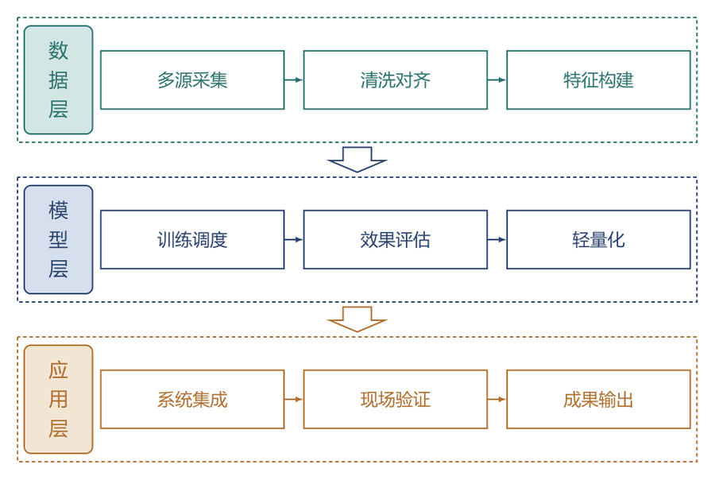

# tikz-framework-diagram

一个 **Agent Skill**：用 TikZ 画中文学术风格的**研究框架图 / 技术路线图 / 系统架构图**。

TikZ 默认画出来的图一看就是"代码生成"的：字号随意、留白不匀、箭头是实心粗箭头。
这很正常——TikZ 只管几何，不管版面。而这个技能把"论文插图应该长什么样"编码成了一套**设计令牌 + 版式骨架 + 图元库**，
让输出直接具备期刊插图的排版质感：白底黑线、灰阶分层、严格正交、留白均匀。

> 仓库是承载这个 skill 的项目：README / LICENSE 在根目录，skill 本体在 [`tikz-framework-diagram/`](tikz-framework-diagram) 子目录，
> 结构与安装到 skills 目录里的完全一致，拷走即用，无平台专有依赖。

## 风格长什么样

- **白底 + 黑线**，灰阶只用于表达层级：`#F2F2F2` 侧边列 / `#D9D9D9` 区块标题 / `#BFBFBF` 顶层分组
- **严格三级网格**：栏 → 行 → 元素，同类元素同高同宽
- **中文竖排标签**：左侧一条窄框，单字一行，首末字与框边对称
- **虚线只管分组**，不用于强调；点线只用于次级容器
- **两种箭头**：空心块箭头（层级递进）、细实心箭头（元素流转）
- **字号只有 4 级**：11pt 标题 / 8.3pt 粗体区块标题 / 8.3pt 正文 / 6.5pt 小注
- **两套配色**：单色灰阶（默认，黑白印刷）/ 彩色（三色系 + 中性灰，浅填充 + 深描边，深档灰度拉开 ≥20 保证转黑白仍可辨）

 

彩色方案（同一套骨架，只换配色）：



## 五种版式成品

| 示例 | 版式 | 亮点 |
|---|---|---|
| [`01-top-level-plan`](tikz-framework-diagram/assets/examples/01-top-level-plan) | 单列纵向 + 左侧贯穿大箭头 | 最小可用样例 |
| [`02-research-framework`](tikz-framework-diagram/assets/examples/02-research-framework) | 三列框架（步骤 / 内容 / 方法） | 5 个虚线单元、树形支架、竖排标签 |
| [`03-tech-architecture`](tikz-framework-diagram/assets/examples/03-tech-architecture) | 分层架构 | 圆柱、立体卡片、胶囊标题、双向箭头 |
| [`04-color-scheme`](tikz-framework-diagram/assets/examples/04-color-scheme) | 分层架构（彩色） | 三色系色板、浅填充 + 深描边、细箭头 |
| [`05-dual-palette`](tikz-framework-diagram/assets/examples/05-dual-palette) | 泳道式（四道 × 六环节） | 24 环节的密度；同一份内容出单色 / 彩色两版，合并在一个 LaTeX 文件 |

每个目录都有 `fig.tex`（可 `xelatex` 直接编译）、`fig.pdf`、`preview.png`；
`02` / `03` 还带 `gen.py`，是从坐标表生成 `.tex` 的完整例子。

## 安装

标准 **Agent Skill**：`SKILL.md` + YAML frontmatter + `references/` `scripts/` `assets/`，
遵循通用 skill 目录约定，凡支持该规范的智能体都能直接加载。

```bash
git clone https://github.com/whlle-yi/tikz-framework-diagram.git
cp -r tikz-framework-diagram/tikz-framework-diagram <你的 skills 目录>/
```

skills 目录通常在用户主目录下（如 `~/.claude/skills/`），也可放在项目内随仓库分发；具体路径以你所用的客户端为准。

## 怎么用

装好后直接说需求即可：

> "帮我画一张技术路线图：分四层，数据采集 → 模型训练 → 模型优化 → 成果落地，每层三四个环节，中文标注，论文用。"

技能会走这条链路：

1. **定版式** —— 从六种骨架里选（单列 / 三列框架 / 分层架构 / 树形分解 / 矩阵对照 / 泳道式），先出层级清单
2. **套令牌** —— 单色或彩色二选一：字号、灰阶（或色板）、线宽、圆角、间距、箭头尺寸全部取自令牌表
3. **选图元** —— 矩形 / 圆角 / 胶囊 / 圆柱 / 立体卡片 / 块箭头 / 树形支架 / 共边标签框
4. **写生成器** —— 用 `scaffold.py` 的数据表结构，不手写 `.tex`
5. **编译** —— `xelatex`，中文字体走 `xeCJK`
6. **自检** —— 过一遍 12 项检查清单再交付

## 仓库结构

```
.
├── README.md
├── LICENSE
├── .gitignore
├── .gitattributes
└── tikz-framework-diagram/          ← skill 本体
    ├── SKILL.md                     入口：三条原则 + 6 步工作流 + 索引
    ├── references/
    │   ├── 01-style.md              视觉语言与设计令牌表（核心）
    │   ├── 02-layouts.md            六种版式骨架 + 结构参数
    │   ├── 03-shapes.md             图元库
    │   ├── 04-text.md               中文排版：字号层级、逐字逐行定位、断行
    │   ├── 05-tex-setup.md          工程配置：单位换算、字体、线宽、颜色
    │   ├── 06-checklist.md          交付前 12 项自检
    │   ├── 08-pitfalls.md           15 条踩坑
    │   └── 09-color.md              彩色方案：色板、映射、灰度可辨性检查
    ├── scripts/
    │   └── scaffold.py              生成器骨架
    └── assets/examples/             三份可直接编译的成品
```

## 试试看

```bash
cd tikz-framework-diagram/assets/examples/03-tech-architecture
python gen.py && xelatex fig.tex        # 改 gen.py 里的坐标表，重跑即可调版
```

## 适用范围与限制

适用：正交排布的研究框架图、技术路线图、系统架构图、方法流程图；中文或中英混排；黑白灰阶印刷。

不适用：

- 自由曲线、手绘风格、大量斜线交叉的图
- 需要还原阴影、渐变、滤镜的效果图
- 数据可视化（那应该用 pgfplots / matplotlib，不是这套骨架）

输出为纯矢量 PDF，缩放不失真，字体嵌入后可直接送印。

## License

[MIT](LICENSE)
